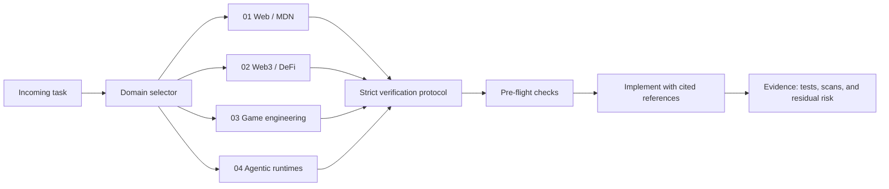

# Nexus-Core

Nexus-Core is a decoupled, governed execution gateway and single source of truth for grounding AI coding agents across Web development, Web3/DeFi, game engineering, and autonomous agent runtimes. It separates routing, verification, domain knowledge, project templates, and continuous guardrails so an agent can make fewer assumptions and produce evidence-backed changes.

## Architecture

The repository is intentionally decoupled from any application code. A project can consume the rules and template without importing this repository as a runtime dependency. Domain selection is explicit; verification is mandatory; knowledge is maintained as human-readable checklists that can be reviewed and evolved independently.

## Repository map

- `.cursorrules`: global agent contract and lifecycle/security directives.
- `core-engine/`: routing, verification, and local pre-flight tooling.
- `knowledge-bases/`: domain-specific correct-versus-anti-pattern checklists.
- `templates/`: Handlebars bootstrap template for new projects.
- `.github/workflows/`: linting and documentation-health guardrails.

## Integration

1. Copy `.cursorrules` into a project root, or render `templates/project-init-template.hbs` with project metadata.
2. Keep the generated local rules linked to this repository at a pinned commit or reviewed branch.
3. Route every task through the domain selector before implementation.
4. Cite official references in design notes, pull requests, or agent output.
5. Run `core-engine/pre-flight-check.sh path/to/target` locally and in CI.
6. Treat CI failures as blocking until the underlying standard, guard, or documentation issue is resolved.

## Operating principles

- **Native first:** platform APIs and established protocols beat unnecessary abstraction.
- **Evidence before code:** references and verification output precede implementation.
- **Lifecycle ownership:** every resource has a cleanup path and an explicit owner.
- **Security by boundary:** validate inputs and constrain capabilities at every external boundary.
- **Version awareness:** deprecations and upstream changes are tracked rather than silently assumed away.

## Scope and maintenance

This repository is a reference contract, not a substitute for threat modeling, audits, tests, or official documentation. Upstream documentation remains authoritative. When a rule conflicts with an upstream standard, pause implementation, record the discrepancy, and update Nexus-Core after verification.
