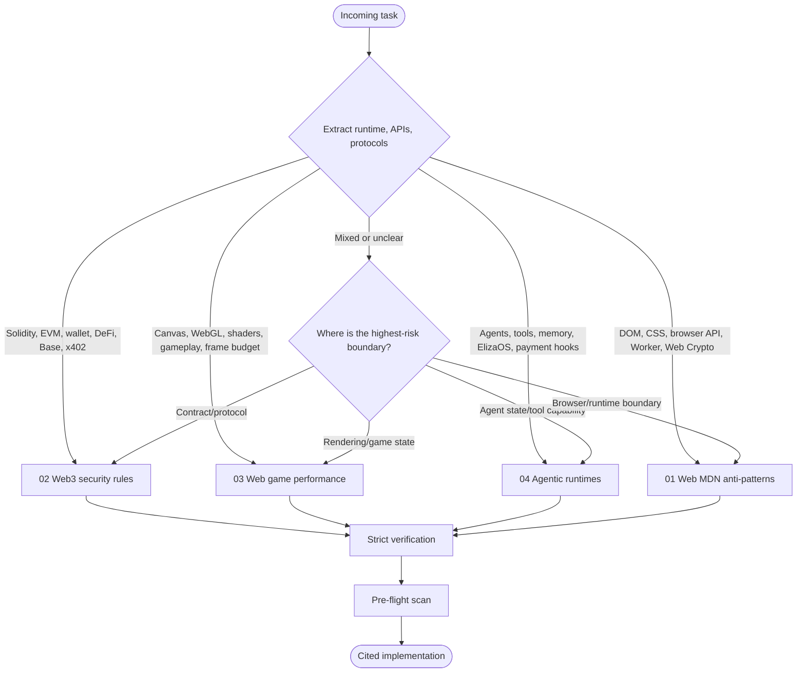

# Domain selector

Use this routing algorithm before implementation. A task may have a primary domain and secondary domains; apply every relevant knowledge base, beginning with the domain that owns the highest-risk behavior.

## Algorithm

1. Extract nouns, runtime targets, protocols, and artifacts from the task.
2. If the task includes Solidity, EVM transactions, wallets, chains, smart contracts, DeFi, Base, or x402, route to **Web3/DeFi**.
3. Else if it includes Canvas, WebGL, shaders, frame budgets, collision math, gameplay, input loops, or asset streaming, route to **Game engineering**.
4. Else if it includes autonomous agents, tool calls, memory, state machines, ElizaOS, model orchestration, or micropayment hooks, route to **Agentic runtimes**.
5. Else if it includes DOM, CSS, browser APIs, workers, service workers, Web Crypto, HTTP, accessibility, or frontend performance, route to **Web**.
6. For mixed tasks, select the domain containing the security or correctness boundary as primary and attach the others as secondary.
7. Read the selected knowledge base and cite official sources before implementation.
8. Run the strict verification protocol and pre-flight checks against the target.
9. Record the route, references, checks, and unresolved risks in the implementation evidence.

## Mermaid flowchart

